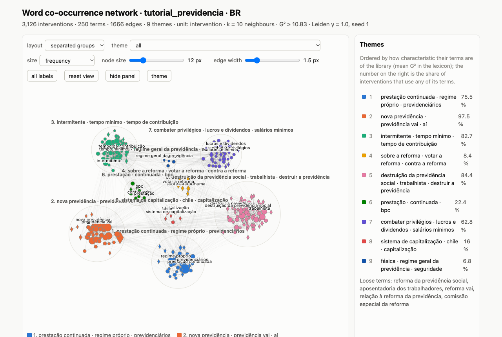
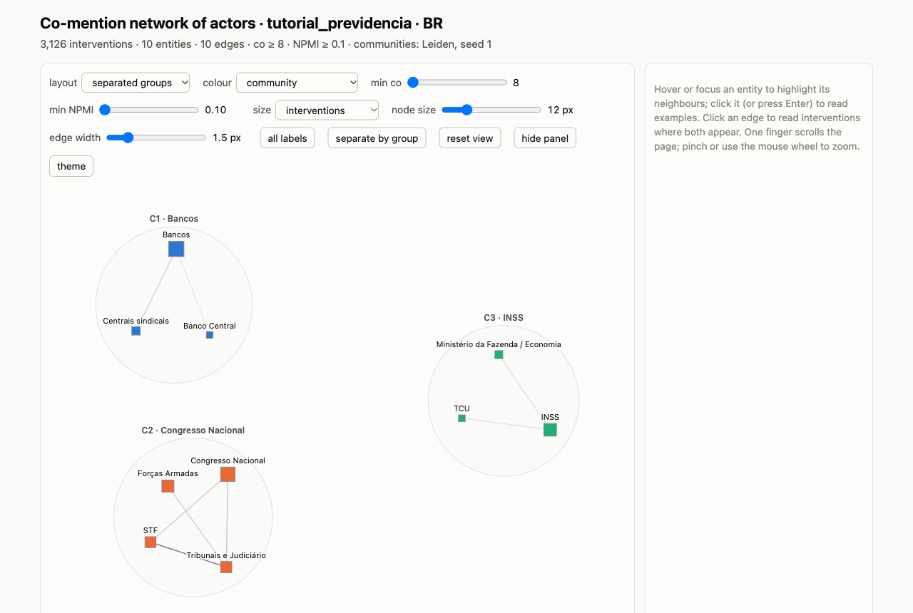
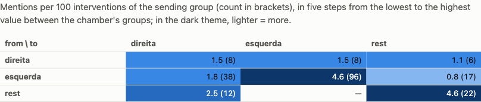

# Tutorial: ParlaIbero from an agent

*[Versión en español](TUTORIAL.md)*

The ParlaIbero MCP server lets an agent (Claude, the ChatGPT desktop app, Codex, Cursor…) search, count, compare and
read the 10 million plenary interventions of 16 Ibero-American parliaments. No programming is needed: you ask in
plain language and the agent picks the tool. This tutorial walks through the functions with real questions and what
the server returns.

**How to read the examples.** Each one has four parts:

> **Ask:** what you write to the agent.
>
> *The agent uses* the tool and its main parameters.

Then comes an excerpt of the result and a note on how to read it. The results are real: they were obtained with
parlaibero-mcp 0.6.0 on the 2.0 versions of the Dataverse datasets, and the script [`ejemplos.py`](ejemplos.py)
reproduces them. They are trimmed, and quotations of speeches leave out the speaker's name. The answer the agent
writes will vary; the data will not.

**Contents**

0. [Getting started](#0-getting-started)
1. [Check the base before interpreting](#1-check-the-base-before-interpreting)
2. [Words over time](#2-words-over-time)
3. [Who speaks](#3-who-speaks)
4. [What distinguishes two groups](#4-what-distinguishes-two-groups)
5. [A library for one topic](#5-a-library-for-one-topic)
6. [Reading in context](#6-reading-in-context)
7. [Three networks, three questions](#7-three-networks-three-questions)
8. [Reproduce, export and cite](#8-reproduce-export-and-cite)
9. [The whole case in eight requests](#9-the-whole-case-in-eight-requests)
10. [Tools at a glance](#10-tools-at-a-glance)

---

## 0. Getting started

**Install.** You need [uv](https://docs.astral.sh/uv/getting-started/installation/). In Claude Code:

```bash
claude mcp add parlaibero -s user -- uvx parlaibero-mcp
```

In Claude Desktop, Cursor, Gemini CLI and most other clients, add this block to their configuration (the other
variants are in the [README](../../mcp/README.md)):

```json
{ "mcpServers": { "parlaibero": { "command": "uvx", "args": ["parlaibero-mcp"] } } }
```

**What is there and what do I have.**

> **Ask:** "Which parliaments does ParlaIbero have, and which have I already downloaded?"
>
> *The agent uses* `list_countries`.

```text
AR  Argentina  ParlaIbero-AR (1983-2025)  v2.0  844 MB    downloaded: 258,808 rows, 1,086 sessions
BR  Brazil     ParlaIbero-BR (2003-2025)  v2.0  1,457 MB  downloaded: 1,657,113 rows, 7,731 sessions
…   (16 countries, each with its own DOI in Harvard Dataverse)
```

> **Ask:** "Download Brazil."
>
> *The agent uses* `download_country` (`country="BR"`).

Each country is downloaded once (0.5 to 1.5 GB, a few minutes), MD5-verified, and loaded into a local DuckDB
database in `~/.parlaibero`. From then on everything is computed on your computer. The server sends nothing: it only
downloads the data from Dataverse and, for the word network, the Diarios Explorer's expression tables.

---

## 1. Check the base before interpreting

Before reading a trend you need to know how much text lies behind each year.

> **Ask:** "How complete is the Brazilian base since 2015?"
>
> *The agent uses* `coverage` (`countries=["BR"], by="year", date_from="2015-01-01"`).

| year | sessions | words of speech | linked to a deputy |
|---|---:|---:|---:|
| 2015 | 485 | 11,755,593 | 96.0 % |
| 2016 | 407 | 9,774,223 | 96.9 % |
| 2017 | 512 | 10,381,908 | 98.9 % |
| 2018 | 338 | 5,861,262 | 98.8 % |
| 2019 | 486 | 6,602,044 | 98.8 % |
| 2020 | 206 | 5,178,959 | 98.6 % |

Summary: no year is missing and none has a thin base; 99 % of the speech is linked to a deputy.

**How to read it.** The number of words changes a lot from year to year (2018 and 2020 have half as many as 2015).
That is why trends are measured per million words, not in raw counts. `coverage` flags thin years (`low_base`) and
missing ones.

> **Ask:** "Compare Argentina and Spain in 2022 and 2023."
>
> *The agent uses* `coverage` (`countries=["AR","ES"], date_from="2022-01-01", date_to="2023-12-31"`).

```text
AR  long_turn_words_pct 19.3 %   (2022: 20.4 %; 2023: 17.6 %)
ES  long_turn_words_pct  0.8 %
```

> [!WARNING]
> **Documents read into the record.** In some records, reports, bills and lists read aloud stay as speech because
> the record does not separate them. In Argentina, 19 % of the words of those years are in turns of more than 10,000
> words; in Spain, under 1 %. To compare words across countries, repeat the analysis with `max_turn_words=10000`.

> **Ask:** "What known limitations does the Brazilian corpus have? In Spanish."
>
> *The agent uses* `get_documentation` (`country="BR", document="known_limitations", language="es"`).

It returns the document deposited with the data, with each limitation and its measured figure. `get_documentation`
also serves the README, the data dictionary, the build report and the linkage figures, in English, Spanish and
Portuguese.

---

## 2. Words over time

> **Ask:** "Chart when people started talking about "fake news" in Brazil, Spain, Argentina and Mexico since 2010,
> one line per country, and save it as SVG."
>
> *The agent uses* `ngram_viewer` (`terms="fake news", countries=["BR","ES","AR","MX"], split_by_country=true,
> smoothing=1, chart_path=".../fake_news.svg", language="en"`).


| country | first year | peak | occurrences |
|---|---:|---:|---:|
| Brazil | 2017 | 143.5 per million (2023) | 4,692 |
| Spain | 2017 | 13.5 per million (2019) | 214 |
| Argentina | 2017 | 7.0 per million (2024) | 48 |
| Mexico | 2019 | 0.4 per million (2021) | 11 |

**How to read it.**

- **It is a rate, not a count:** occurrences per million words of each year, comparable across years and countries.
- **Smoothing** (`smoothing=1`) averages each year with the one before and the one after, as Google Ngram does.
- **Every point carries its base:** words, sessions and whether the base is thin. A high rate on few words weighs
  little.
- `chart_path` ends in `.svg` (a figure for a paper) or `.html` (a page with values on hover, dark mode and a table).

> [!NOTE]
> **Portuguese and Spanish.** Brazil and Portugal speak Portuguese: a Spanish term will not match there. To compare,
> join both forms with `+`: `"corrupción+corrupção"`. Searches ignore case and accents, and a trailing `*` matches a
> prefix (`democrati*`).

> **Ask:** "How many times has "reforma da previdência" (pension reform) been said in the Câmara, who says it most,
> and when did it first appear?"
>
> *The agent uses* `term_counter` (`terms="reforma da previdência", countries=["BR"]`).

```text
13,386 occurrences · 8,118 interventions · 1,862 sessions · 920 speakers
by sex, per million words:  women 78.5 · men 64.1
parties with most occurrences: PT 4,448 (94.8 per million) · PSOL 1,156 (170.6) · PCdoB 839 (112.6)
first use: 2003-01-01 · last: 2025-12-16
```

**How to read it.** The PT says it most often, but the smaller PSOL says it almost twice as often per million of its
words. Rates per million correct for the size of each group. For the year-by-year series, by legislature or by party,
there is `term_frequency` (`by="year"`, `"party"`, `"legislature"`…).

---

## 3. Who speaks

> **Ask:** "Do Spanish women deputies speak in proportion to their seats? By legislature since 2004, leaving out the
> chair."
>
> *The agent uses* `share_of_voice` (`countries=["ES"], by="sex", per="legislature", exclude_chair=true`).

| legislature | years | women's voice | weight on the register | voice / weight |
|---|---|---:|---:|---:|
| VIII | 2004–2008 | 25.7 % | 35.8 % | 0.72 |
| X | 2011–2015 | 29.5 % | 39.3 % | 0.75 |
| XII | 2016–2019 | 32.5 % | 41.3 % | 0.79 |
| XIV | 2020–2023 | 38.4 % | 42.5 % | 0.90 |
| XV | 2023–2025 | 37.9 % | 44.4 % | 0.85 |

**How to read it.** "Voice" is the share of the words spoken by women deputies; "weight", their share of the register
for the legislature. A ratio of 1 would mean speaking in proportion to their seats. The gap has narrowed but not
closed. Voice is measured over linked deputies: ministers and other voices without a seat are outside the
denominator, and the result says how much speech that leaves in.

> [!WARNING]
> **The chair.** Whoever chairs the sitting speaks many procedural turns ("the floor goes to…"). In comparisons
> between groups it can dominate the result: use `exclude_chair=true` in `share_of_voice` and `distinctive_words`.

> [!NOTE]
> **Sex, party and district** come from the deputy register and are empty when the speaker could not be linked
> (ministers, clerks, collective voices). Linkage and its limits differ between countries: check them with
> `coverage` and `get_documentation(..., "known_limitations")` before comparing.

---

## 4. What distinguishes two groups

> **Ask:** "Which words distinguish the PT from the PL in the current legislature (2023–2025), leaving out the
> chair?"
>
> *The agent uses* `distinctive_words` (`field="party", a="PT", b="PL", countries=["BR"], date_from="2023-01-01",
> date_to="2025-12-31", exclude_chair=true, top=15`).

| most PT | z | most PL | z |
|---|---:|---|---:|
| renda (income) | 33.5 | não (no) | −44.4 |
| trabalhadores (workers) | 33.3 | eu (I) | −41.9 |
| educação (education) | 32.3 | esquerda (the left) | −40.3 |
| políticas (policies) | 32.2 | deus (God) | −33.6 |
| programa | 32.1 | stf (Supreme Court) | −29.1 |
| deputadas (women deputies) | 30.2 | oposição (opposition) | −27.4 |
| fome (hunger) | 26.3 | desgoverno (misgovernment) | −26.5 |
| desenvolvimento (development) | 26.2 | minoria (minority) | −25.5 |

**How to read it.** The method is the weighted log-odds ratio with a Dirichlet prior (Monroe, Colaresi and Quinn
2008): it weighs differences that are not due to chance and does not reward rare words. An |z| above 1.96 is
significant; with corpora this size nearly every word clears it by far, so the order is what matters. Here the
governing party talks about policies (income, education, hunger). The opposition speaks in the first person, with
negations, about its adversaries (the left, the Supreme Court) and the "desgoverno". Function words are not removed:
they are style too.

Groups can be parties, sex (`"F"`/`"M"`), periods (`"2003-2010"` against `"2019-2022"`), countries, one deputy
(`id_dep`) or a library against the rest (section 5).

---

## 5. A library for one topic

A **library** is a named subset of interventions: a topic, a period, a group, from one or several countries. It is
saved, and every analysis tool takes `library=` to work inside it. The rest of the tutorial follows one case: the
pension reform in Brazil.

> **Ask:** "Create a library "tutorial_previdencia" with the Câmara's interventions that discuss the pension reform
> between PEC 287 (December 2016) and its enactment (November 2019): those that use "reforma da previdência",
> "previdência social" or "aposentadoria*" at least twice. Leave out the chair."
>
> *The agent uses* `library_create` (`name="tutorial_previdencia", countries=["BR"],
> terms="reforma da previdência+previdência social+aposentadoria*", min_occurrences=2, date_from="2016-12-01",
> date_to="2019-11-30", exclude_chair=true`).

```text
tutorial_previdencia · BR
3,126 interventions · 505 sessions · 466 speakers · 1,716,163 words
2016: 127 · 2017: 1,283 · 2018: 243 · 2019: 1,473
linked: 98.6 % · women: 15.2 % of the speakers with known sex · long turns: 0.7 %
```

**How to read it.** `min_occurrences=2` keeps the interventions that **discuss** the topic, not those that mention it
in passing. The years show the two rounds of the bill (2017 and 2019). `library_describe` gives this portrait again
whenever needed.

Libraries can also take several countries at once (with each language's forms), be aligned on an event
(`event_dates` with `days_before`/`days_after`), be edited by hand (`library_edit`, with notes and tags) and be
combined (`library_combine`: union, intersection, difference).

> **Ask:** "Which vocabulary sets that library apart from the rest of the Câmara in the same period?"
>
> *The agent uses* `distinctive_words` (`field="library", a="tutorial_previdencia", countries=["BR"],
> date_from="2016-12-01", date_to="2019-11-30", exclude_chair=true`).

```text
previdência (z 185.5) · reforma (174.7) · aposentadoria (87.4) · social (60.4) · idade (58.8)
trabalhadores (58.6) · contribuição (58.0) · anos (57.5) · aposentar …
```

It is a quick check that the library holds the topic you were after.

---

## 6. Reading in context

Counting is not enough: you have to read.

> **Ask:** "Show me six examples of "regra de transição" (transition rule) in the library."
>
> *The agent uses* `kwic` (`pattern="regra de transição", library="tutorial_previdencia", n=6, width=80`).

```text
68 interventions contain the phrase; random sample of 6 (reproducible: seed=1)
2017-05-10 PTB   … a proposta do Governo previa [regra de transição]. O Relator retirou essa …
2019-04-15 PT    … porque quer estabelecer outra [regra de transição] para quem já está numa …
2017-10-19 PT    … idade mínima, tempo de contribuição mínima e [regra de transição] — esse é o cerne …
2019-04-17 PDT   … que não há [regra de transição] colocada na PEC 06/19. Sai da regra antiga …
2019-03-12 PODE  … vamos garantir uma [regra de transição] justa, que trate iguais como iguais …
```

**How to read it.** Each line carries the date, the party and the intervention's identifier (`id_int`). With it,
`get_intervention` returns the full text (and, if asked, the surrounding turns), and `get_session` the order of the
whole sitting. `search_text` searches from newest to oldest, with filters by party, sex or deputy.

> **Ask:** "Which words keep company with "privilégio" (privilege) and its forms in the library?"
>
> *The agent uses* `collocations` (`pattern="privilégio*", library="tutorial_previdencia", top=15`).

```text
421 interventions · 776 occurrences
combater (fight, G² 876.8) · combate (378.5) · acabar (end, 240.9) · combatendo (82.9) · cortar (cut, 81.6)
atacar (attack, 78.1) · nenhum (none, 71.7) · ataca (63.9) · tira (takes away, 48.9) · mexe (touches, 48.0)
```

**How to read it.** These are the words found within ±5 words of the term more often than in the rest of the same
interventions (Dunning's G²; above 10.8, p < 0.001). Privileges are something to "fight", "cut" or "attack". But
collocations do not say who speaks or with what intent. "Combater privilégios" (fight privileges) was the
government's slogan, and in this library it is said mostly by the left: 114 of the 140 interventions with that
construction. To know whether they adopt it or dispute it you have to read the examples with `kwic` and repeat the
analysis with `party=`.

---

## 7. Three networks, three questions

The server builds three different networks that are **never mixed**, because they answer different questions:

| tool | nodes | a link means | question |
|---|---|---|---|
| `cooccurrence_network` | the library's words and expressions | they occur together more than expected | what is talked about: themes |
| `comention_network` | actors you define: people and institutions | they are mentioned in the same intervention | which actors are discussed together, and by whom |
| `mention_network` | people: speakers, deputies, external actors | A names B on the floor | who talks about whom |

All three write to a folder (absolute path) an interactive page with tables, CSV, JSON and a summary. The pages have
three layouts (force, separated groups and rings), up to 30 colours, adjustable node size and a side panel that can
be hidden.

### 7.1 Words and themes

> **Ask:** "Build the word network of the library and group it into themes. Leave out people's names. Save the pages
> in ~/previdencia/networks."
>
> *The agent uses* `cooccurrence_network` (`library="tutorial_previdencia", exclude=[...names...],
> layout="clusters", output_dir="..."`).



| theme | central terms | interventions | parties that use it most (per 1,000 words) |
|---|---|---:|---|
| Eligibility rules | tempo de contribuição, idade mínima, anos de contribuição, homens, mulheres | 83 % | PDT 16.2 · PSB 15.9 · PT 14.8 |
| The opposition's reading | destruição da previdência social, golpe, governo ilegítimo, reforma trabalhista, direitos | 84 % | PT 15.5 · PCdoB 13.4 · PSOL 12.1 |
| Accounts and pension schemes | déficit, regime próprio, regime geral, fiscal, gastos, benefícios | 76 % | PTB 11.5 · PSD 9.5 · NOVO 9.2 |
| Privilege and inequality | combater privilégios, lucros e dividendos, grandes fortunas, salário mínimo, abono salarial | 63 % | PDT 9.0 · PSOL 8.7 · PSB 8.1 |
| Welfare benefit and rural pensions | benefício de prestação continuada, BPC, aposentadoria rural, idosos | 22 % | PTB 2.5 · PRB 1.6 · PSD 1.5 |
| Capitalisation | sistema de capitalização, Chile, regime de capitalização, bancos | 16 % | PDT 1.3 · PSB 1.1 · NOVO 1.1 |

There is also the chamber's common register ("vai", "governo", "agora": 98 % of the interventions, not a theme) and
two procedural themes (the vote and the special committee).

**How it is made.** It is the Diarios Explorer's method, ported and checked against its code:

- **Vocabulary:** the library's 250 most characteristic words and expressions against the rest of the country's corpus
  (signed G²), without numbers or stopwords. The corpus's expressions ("regra de transição", "lucros e dividendos")
  are one node each.
- **Links:** two terms are joined if they occur in the same intervention more than expected (G² ≥ 10.83) and the link
  is among the 10 strongest of either term.
- **Themes:** Leiden communities of three terms or more, ordered by how characteristic they are of the library.

**How to read it.** The rate per 1,000 words compares parties of different size: the PT uses the vocabulary of "the
destruction of social security" 15.5 times per 1,000 of its words; the NOVO, 3.7. Each theme suggests the
interventions to read first (`read_first`). For finer themes, raise the resolution (`resolution=1.6`); to focus on
something else, exclude terms (`exclude`). The unit can be the intervention or 20-word fragments
(`unit="fragment"`).

### 7.2 Actors mentioned together

> **Ask:** "Which institutions are mentioned together in those debates, and which do the left and the right name
> more? Use INSS, Congresso Nacional, STF, TCU, the Finance or Economy Ministry, the Central Bank, the trade-union
> federations, banks, the Armed Forces and the Judiciary. Left: PT, PSOL, PCdoB, PDT, PSB, REDE; right: PSL, PL, PR,
> PP, DEM, PSC, PRB, Republicanos, NOVO, PTB, Patriota."
>
> *The agent uses* `comention_network` (`library="tutorial_previdencia", entities=[{name, type: "institucion",
> pattern}...], groups={"esquerda": [...], "direita": [...]}, min_co=8, layout="clusters"`).



```text
10 actors · 10 links · 3 communities
  C1: Bancos · Centrais sindicais · Banco Central
  C2: Congresso Nacional · STF · Tribunais e Judiciário · Forças Armadas
  C3: INSS · TCU · Ministério da Fazenda / Economia
bias (+ left, − right): Centrais sindicais +1.00 · Bancos +0.56 · Tribunais e Judiciário −0.29
alerts: "bancos", "militares", "tribunais" and "economia" are nearly always written in lower case: they are also common words
```

**How to read it.**

- **co** counts the interventions that name both actors (volume); **NPMI** measures how much more than expected they
  appear together (affinity, from −1 to 1). Read them separately: two very frequent actors have a high co and an NPMI
  close to 0.
- **Bias** compares the share of each group's interventions that name the actor. Between left and right, only the
  left names the trade-union federations, and mostly the left names the banks.
- **The alerts** point to ambiguous patterns: read each actor's examples (click the node) before interpreting.

> [!IMPORTANT]
> **Actors only.** `comention_network` takes people and institutions (`type: "persona"` or `"institucion"`). Words,
> ideas and concepts belong in `cooccurrence_network`: given a `concepto`, it refuses it. Without `entities`, it
> proposes candidates (proper names and acronyms from a sample) and builds nothing until you confirm them. Patterns
> are RE2 regular expressions over lower-case, accent-free text (no look-arounds).

> [!NOTE]
> **The automatic co threshold** is `max(5, N/120)`: 26 in a library of 3,126 interventions. In small libraries it
> leaves out the less-named actors; here it was lowered to 8.

### 7.3 Who names whom

> **Ask:** "In those debates, who names whom? Group by left and right."
>
> *The agent uses* `mention_network` (`library="tutorial_previdencia", target_scope="speakers", groups={...},
> min_mentions=3, layout="rings"`).



**How to read it.** The left mostly names the left itself (4.6 mentions per 100 of its interventions, 96 in all) and
much less the right (1.8). The right spreads its mentions (1.5 to each side). The E-I index sums it up: −0.27 for
the left (it talks about its own), +0.27 for the right (it talks about the others).

The page also draws the network of people, with arrows from who names to who is named, in rings (the most connected
in the centre) or in groups. Names come from the register of deputies in office that day: by full name, or by surname
after a parliamentary title. Homonyms are resolved by the title's gender or the party written next to the name;
otherwise they are listed apart and never guessed. `validation_sample` writes a sample to check by hand, and
`external_actors` adds people from outside the floor (ministers, judges) by their role or aliases.

---

## 8. Reproduce, export and cite

> **Ask:** "How many interventions of the library are there per year? Do it in SQL."
>
> *The agent uses* `query_sql` (a read-only DuckDB query; `describe_data` gives the schema).

```sql
SELECT year(i.date) AS ano, count(*) AS intervencoes
FROM interventions i
WHERE i.id_int IN (SELECT it.id_int FROM lib.library_items it
                   JOIN lib.libraries l ON l.id = it.library_id
                   WHERE l.name = 'tutorial_previdencia')
GROUP BY 1 ORDER BY 1
```

```text
2016: 127 · 2017: 1,283 · 2018: 243 · 2019: 1,473
```

> **Ask:** "Save that table as CSV so I can carry on in R."
>
> *The agent uses* `export_result` (`sql=..., path="~/previdencia/per_year.csv"`). Parquet works too.

> **Ask:** "Export the library to open it in the Diarios Explorer."
>
> *The agent uses* `library_export` (`name="tutorial_previdencia", folder="..."`): one `.2replib` file per country and
> an index. Import each `.2replib` in the explorer with its own country's CSV loaded.

> **Ask:** "Write a methods note with everything we have done."
>
> *The agent uses* `query_log` (`methods_path="~/previdencia/methods.md"`).

```markdown
# Data and queries
Data: ParlaIbero (Harvard Dataverse, CC BY 4.0), one dataset per country:
- Brazil: https://doi.org/10.7910/DVN/VTXNW3, version 2.0
…
Analyses run with parlaibero-mcp:
- 2026-10-23T14:56:02 · `term_counter` · {"terms": "reforma da previdência", "countries": ["BR"], …}
…
```

> **Ask:** "How do I cite the Brazilian data?"
>
> *The agent uses* `how_to_cite` (`country="BR"`).

```text
Rodrigues-Silveira, Rodrigo, 2026, "ParlaIbero-BR: Parliamentary Speeches from Brazil (2003-2025)",
https://doi.org/10.7910/DVN/VTXNW3, Harvard Dataverse, V2
```

> [!NOTE]
> **Versions.** Identifiers (`id_int`, `id_session`) are stable within a published version, not across versions.
> Cite each dataset with its version. When a new edition is downloaded, `library_rebuild` rebuilds the libraries on
> it.

---

## 9. The whole case in eight requests

1. "How complete is the Brazilian base between 2016 and 2019?" (`coverage`)
2. "When and how much was "reforma da previdência" discussed?" (`ngram_viewer`, `term_counter`)
3. "Create a library with the interventions that discuss the reform…" (`library_create`)
4. "Which vocabulary sets it apart from the rest of the floor?" (`distinctive_words`, `field="library"`)
5. "Show me examples of "regra de transição" and which words keep company with "privilégio"." (`kwic`,
   `collocations`)
6. "Build the word network and its themes." (`cooccurrence_network`)
7. "Which institutions are mentioned together, and who names whom?" (`comention_network`, `mention_network`)
8. "Write the methods note and tell me how to cite the data." (`query_log`, `how_to_cite`)

---

## 10. Tools at a glance

| to… | tools |
|---|---|
| see what there is and download it | `list_countries`, `download_country`, `import_from_folder` |
| know the data | `get_documentation`, `describe_data`, `coverage` |
| count words | `ngram_viewer`, `term_counter`, `term_frequency` |
| compare groups | `share_of_voice`, `distinctive_words` |
| read | `kwic`, `collocations`, `search_text`, `get_intervention`, `get_session` |
| work on one topic | `library_create`, `library_describe`, `library_edit`, `library_combine`, `library_rebuild`, `library_delete`, `library_export`, `library_import` |
| networks | `cooccurrence_network` (words and themes), `comention_network` (actors), `mention_network` (who names whom) |
| reproduce and cite | `query_sql`, `export_result`, `query_log`, `how_to_cite` |

The technical detail of each tool is in the [server README](../../mcp/README.md), and the network method in the
resource `parlaibero://methods/networks` (also in
[`methods_networks.md`](../../mcp/src/parlaibero_mcp/methods_networks.md)).
